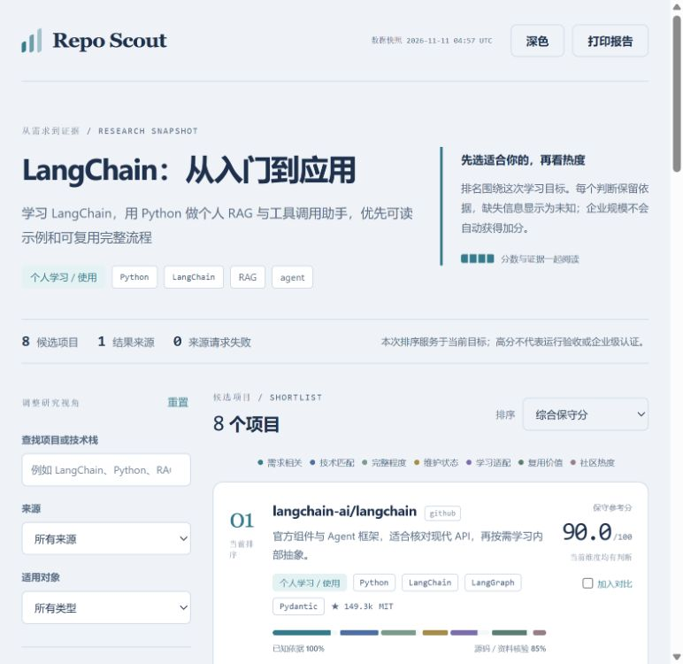
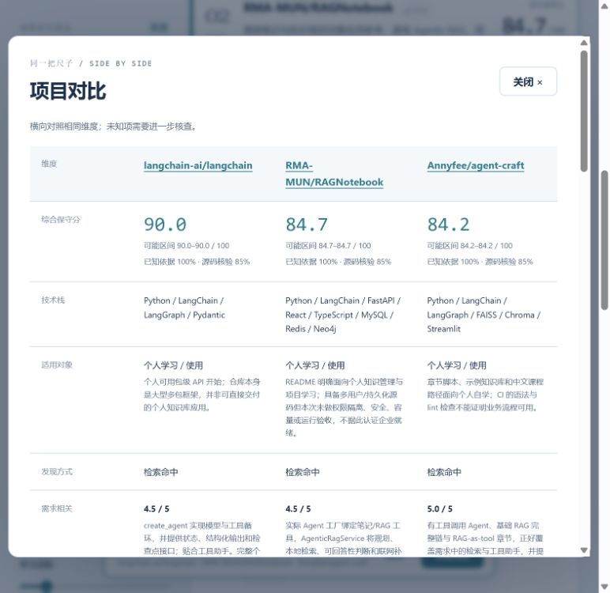

# Repo Scout · Open-source project discovery and comparison AI Skill

[简体中文](README.md) | **English**

**Describe your goal. Find open-source projects and AI tools worth trying.**

Find Java graduation project references, learn a framework, or compare AI image generation, text-to-video, voice and content creation tools. Repo Scout helps your AI assistant search GitHub, Gitee and GitLab, review capabilities and operating requirements, and create a ranked comparison backed by public evidence.

[Live LangChain report](https://vieneny.github.io/repo-scout/) · [Skill](skills/repo-scout/SKILL.md) · [Example data](examples/langchain/) · [Architecture](docs/architecture.md)

## Easiest start: paste the link and describe your goal

Send this complete request to an AI assistant that can read GitHub content, such as Codex, Claude or ChatGPT when their browsing tools are available:

```text
https://github.com/vieneny/repo-scout 使用这个规范，找一下学习Java的毕设设计项目
```

Or in English:

```text
https://github.com/vieneny/repo-scout Follow this workflow to find Java graduation projects that an undergraduate can understand and adapt.
```

The Repo Scout URL points to the research workflow. The rest of the message is the research goal. Your assistant reads the [Skill entrypoint](skills/repo-scout/SKILL.md) and relevant scenario guide, discovers candidates, checks evidence and ranks them. Defaults favor GitHub and individual learning/use; add sources, device limits, budget or preferences in the same message.

**Try the link first; install the Skill when you want to reuse it.** Browsing, local file access and report creation use the capabilities of your current AI environment. Automated collection/rendering needs Python 3.10+. An assistant with browsing but no script execution can still produce a sourced comparison table.

[Try the LangChain demo](https://vieneny.github.io/repo-scout/) to explore filtering, adjustable weights and project comparison.

## Same workflow, different goals

| Goal | Example request after the repository link | Evidence to compare |
|---|---|---|
| Java graduation project / Spring Boot application | Find understandable projects across several business domains | Business flow, database, frontend/backend, setup, adaptation scope |
| Framework learning | Learn LangChain, Vue or React with readable examples | Versions, prerequisites, examples, complete learning path |
| AI art / image generation / ComfyUI | Find approachable open-source image tools and workflows | Input/output, UI, models, GPU memory, model and asset terms |
| Text-to-video / image-to-video | Find video generation projects for an individual computer | Output samples, duration/resolution evidence, hardware, downloads, cost |
| Video editing / subtitles / voice-over | Find tools that turn scripts into subtitled narrated videos | Assets → voice → subtitles → composition, formats, languages, services |
| Audio / TTS / music generation | Find usable open-source voice and audio tools | Samples, model terms, device requirements, setup burden |
| Writing / presentations / knowledge workflows | Find AI writing, slide generation or knowledge tools | Editable output, citations, import/export, model services and costs |
| Local projects / open-source alternatives | Find similar implementations or alternatives to my project | Capability fit, reusable boundaries, integration and migration effort |

More copyable requests:

```text
https://github.com/vieneny/repo-scout Find open-source AI image generation tools for personal local use. Compare GPU requirements, model terms and setup effort.
```

```text
https://github.com/vieneny/repo-scout Find text-to-video and image-to-video projects. Compare output samples, hardware, cost and reuse value.
```

Repo Scout discovers and compares projects/tools that can achieve the goal. Actually using a selected tool to generate media is a subsequent task. See the [scenario guide](skills/repo-scout/references/scenarios.md) for appropriate evaluation criteria.



## From an idea to a useful shortlist

```text
Repository URL / local project / idea
                  ↓
       Goal + capabilities + constraints
                  ↓
       GitHub / Gitee / GitLab
                  ↓
   Candidate evidence + agent review
                  ↓
  Configurable scoring → offline HTML
```

- **Three starting points:** an existing repository, your local project, or something you want to build or learn.
- **Configurable sources:** GitHub by default, with Gitee and GitLab adapters. Source failures remain visible instead of becoming empty search results.
- **A comparison for your goal:** technologies/workflows, completeness, individual/team suitability, maintenance, popularity and reuse; creative tools add device, model, cost and licensing evidence.
- **Evidence next to the score:** explainable criterion scores, public source links, uncertainty ranges, and source-review coverage.
- **An explorable report:** filter and sort projects, change scoring priorities locally, compare candidates, inspect evidence, and switch themes.
- **A portable artifact:** one self-contained HTML file; no running service, CDN, analytics, or model account is needed to read it.

The presentation takes inspiration from Archify's useful idea of a self-contained, explorable artifact. Repo Scout has its own research workflow, scoring model, and renderer; it does not bundle or require Archify.

## Use regularly: install the Skill

Installation requires a compatible skill host; automated collection and rendering require **Python 3.10+**. The Python helper uses only the standard library. The host agent supplies interpretation and source review; Repo Scout does not require a separate model service.

```bash
npx skills add vieneny/repo-scout --skill repo-scout
```

Choose your host when prompted. For a manual install, copy the complete [`skills/repo-scout`](skills/repo-scout/) folder into your host's skill directory, such as `~/.codex/skills/repo-scout`. Keep its scripts, references, and assets together. No other files in this repository are needed to run the installed skill.

Example requests:

```text
Use $repo-scout. I want to learn LangChain by building a small Python RAG
assistant. Search GitHub, favor projects an individual can understand,
compare implementation completeness and maintenance, and create a report.
```

```text
Use $repo-scout to analyze ./my-project and find comparable open-source
projects on GitHub and Gitee. Explain what I can learn or reuse from each.
```

The skill is host-neutral. Tool names and file paths should be adapted to the abilities of your agent environment; no particular browser, MCP server, or paid search provider is required by the core workflow.

## Run the CLI

Clone the repository, then run commands from its root. `python` may be `python3` on your system. PowerShell users can use the same single-line commands.

```bash
git clone https://github.com/vieneny/repo-scout.git
cd repo-scout
python skills/repo-scout/scripts/repo_scout.py run --idea "Learn LangChain with a small RAG assistant" --stack Python --capability RAG --audience individual --sources github --limit 6 --out-dir ./results/langchain
```

The command writes:

```text
results/langchain/
├── profile.json     Goal, stack, capabilities, and queries
├── search.json      Candidates and per-source search receipts
├── inspected.json   Public metadata and structural evidence
├── report.json      Scores, evidence, uncertainty, and ranking
└── report.html      Self-contained interactive report
```

Repeat `--constraint "Windows" --constraint "Low personal operating cost"` to preserve operating limits for agent review. Constraints are not automatically sent in public search queries.

Open `report.html` in a modern browser. For the other starting points, replace `--idea ...` with `--local ./my-project` or `--repo https://github.com/owner/repository`.

For `run`, **`--limit` is the total inspection budget** (1–30), not a promise that discovery found only that many projects. `search.json` retains collected candidates; `inspected.json` records the inspected count and unreviewed tail. Results from provider/query pairs are interleaved so the first source does not automatically fill the budget.

Repeat `--repo-seed <URL>` to reserve inspection slots for known projects. Seeds come first. A project that is also found through search keeps both origins; aliases resolving to one repository are deduplicated. More distinct resolved seeds than the inspection budget produce a clear error rather than silently dropping seeds. In the separate `search` command, `--limit` instead controls hits per provider/query; `inspect --limit` controls its inspection budget.

**The CLI alone produces an initial heuristic pass.** Metadata and file presence do not prove functionality. For a source-reviewed shortlist, the host agent reads relevant implementations and adds an assessment file:

```bash
python skills/repo-scout/scripts/repo_scout.py score --input ./results/langchain/inspected.json --assessments ./results/langchain/assessments.json --out ./results/langchain/report.json
python skills/repo-scout/scripts/repo_scout.py render --input ./results/langchain/report.json --out ./results/langchain/report.html
```

See the [assessment format](skills/repo-scout/references/assessment.md) and [full workflow](skills/repo-scout/references/workflow.md). Scoring and rendering are fully offline and reproducible from saved inputs.

## What the scores mean

| Dimension | Default weight | Decision it helps with |
|---|---:|---|
| Relevance | 25 | Does it solve the actual problem? |
| Technical and operating fit | 15 | Do its stack, workflow, platform and device requirements fit? |
| Completeness | 15 | Is the relevant workflow implemented and supported by evidence? |
| Maintenance | 10 | What do code activity, releases, and maintainer behavior show? |
| Learning and usability fit | 15 | Can the intended user understand, set up and use it? |
| Reuse value | 15 | What can be reused, under which license and integration cost? |
| Popularity | 5 | What do source-specific attention/adoption signals show? |

Unknown criteria produce a **score interval**, not an invented fact. The displayed score is the conservative lower bound. Coverage shows how much of the scoring weight has evidence; source-review coverage separately shows how much was reviewed by the agent. A scored zero and an unknown are different.

Ranking is specific to the brief and weights. Enterprise-oriented scope is a descriptive label, not a quality bonus. A small example can rank above a large platform when the goal is individual learning. Stars are not users, runtime correctness, or production readiness.

Pass `--config weights.json` to `run` or `score` to change priorities. See [the configuration and formula](skills/repo-scout/references/scoring.md).

## Sources and privacy

| Adapter | Optional environment variables | Notes |
|---|---|---|
| GitHub | `GITHUB_TOKEN` or `GH_TOKEN` | Public API works anonymously within its rate limits. |
| Gitee | `GITEE_TOKEN` | Upstream search availability and permissions can vary. |
| GitLab.com | `GITLAB_TOKEN` | Uses GitLab's public project API, not GitHub query syntax. |

Select one or more with `--sources github,gitee,gitlab`. Tokens are optional provider credentials, read from the environment and never embedded in reports. The adapters' presence does not imply every upstream service is currently reachable; consult each run's receipts. Other hosts can be added through the provider interface.

Local profiling reads bounded known manifests and records technology names and relative filenames. It does not clone, install, or execute candidate projects. Keep proprietary identifiers and secrets out of public search terms, and review profiles/reports before sharing. Third-party repository instructions remain research material.

Repository creation, latest commit, and latest release remain separate facts. Reports also distinguish **collection time** (`retrieved_at`), **inspection completion** (`inspected_at`), and **report generation** (`generated_at`); offline rescoring does not make an old snapshot fresh. Each candidate retains its own metadata retrieval time. A `pushed_at` timestamp can be a fallback signal, not evidence of meaningful recent human work. See [source details](skills/repo-scout/references/providers.md).

## LangChain case study

The included [LangChain example](examples/langchain/) starts with an individual learning brief and includes collected candidates, source assessments, scores, and the final [HTML report](examples/langchain/report.html). [Explore the published report](https://vieneny.github.io/repo-scout/) or download the HTML to read offline; GitHub's file viewer does not execute HTML.

Use the example to understand why a framework, an educational example, and a complete application may receive different learning and reuse judgments. Its Stars and maintenance facts are a dated snapshot, not live counters. The report distinguishes static source review from runtime testing; the candidate projects were not installed merely to produce the comparison.



## Development

```bash
python -m unittest discover -s tests -v
```

The test suite checks data collection boundaries, provider normalization and failures, scoring invariants, and offline report safety. No live credentials or candidate installations are required for unit tests. Read the [architecture](docs/architecture.md), [validation record](docs/validation.md), or [contribution guide](CONTRIBUTING.md) for details.

## Support and feedback

If this saves you search and evaluation time, a [Star](https://github.com/vieneny/repo-scout) helps others discover it. Share concrete use cases, first-use friction or evidence-backed improvements through [Issues](https://github.com/vieneny/repo-scout/issues).

## License

[MIT](LICENSE). Candidate repositories keep their own licenses. Source links and research judgments do not grant permission to reuse third-party code or assets.
