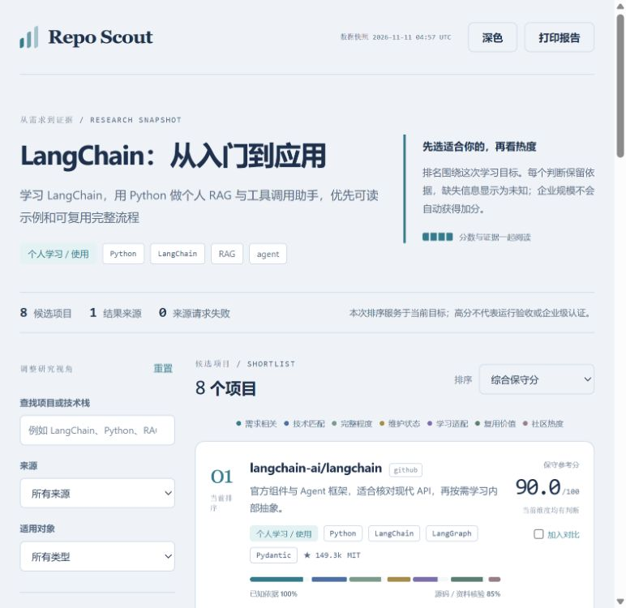
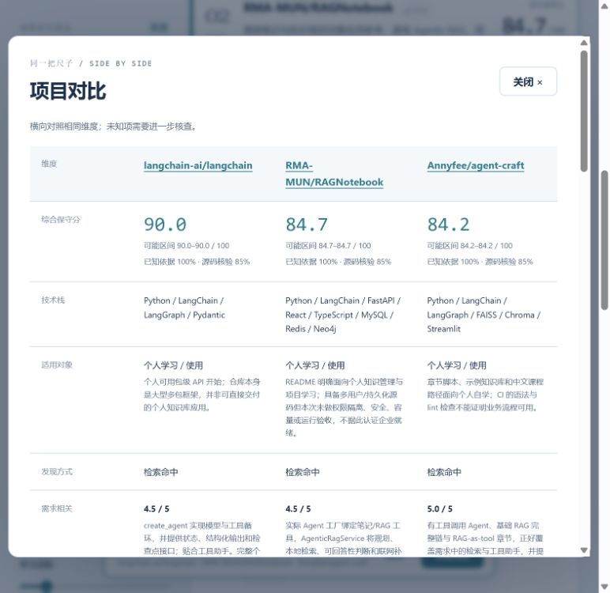

# Repo Scout · 开源项目推荐、对比与选型 AI Skill

**简体中文** | [English](README.en.md)

**一句需求，找到值得学习、使用和借鉴的开源项目与 AI 工具。**

无论是找 Java 毕设参考、学习编程框架，还是筛选 AI 绘画、视频生成、语音或内容创作工具，Repo Scout 都能帮助 AI 助手把需求变成有依据的候选清单：检索 GitHub / Gitee / GitLab，核查能力与使用条件，评分排序，再生成便于阅读的对比报告。

[在线体验 LangChain 报告](https://vieneny.github.io/repo-scout/) · [Skill](skills/repo-scout/SKILL.md) · [案例数据](examples/langchain/) · [项目架构](docs/architecture.md)

## 最简单的用法：贴链接，说需求

把下面**一整句**发给能够读取 GitHub 内容的 AI 助手即可开始，适用于具备相应联网工具的 Codex、Claude、ChatGPT 等环境：

```text
https://github.com/vieneny/repo-scout 使用这个规范，找一下学习Java的毕设设计项目
```

这里的链接用于读取研究规范，后半句描述本次查找目标。AI 会先读 [Skill 入口](skills/repo-scout/SKILL.md) 和相关场景指南，再理解需求、检索候选、核查证据并排序。默认从 GitHub 查找，优先个人学习与使用；你也可以直接补充来源、预算、设备或偏好。

**可以先用链接体验，再按需安装 Skill。** 联网、读取本地文件与生成报告的能力由当前 AI 环境提供；自动采集和渲染脚本需要 Python 3.10+。支持联网但不能执行脚本的助手，可先按同一规范输出带来源的对比表。

想先看效果？打开 [LangChain 在线报告](https://vieneny.github.io/repo-scout/)，试试筛选、调整权重和并排对比。

## 换一句需求，就能换一个场景

| 你想做什么 | 可以接在仓库链接后面的需求 | 会重点比较什么 |
|---|---|---|
| Java 毕业设计 / Spring Boot 项目 | 找适合本科生理解和二次开发的 Java 毕设项目，多给几个业务领域 | 业务闭环、数据库、前后端、安装资料、改造空间 |
| 学框架 / 找示例 | 学习 LangChain、Vue 或 React，找循序渐进的可读项目 | 版本、示例、概念负担、完整流程、学习路线 |
| AI 绘画 / 图像创作 | 找好上手的开源 AI 绘画或 ComfyUI 工作流 | 输入输出、操作界面、模型、显存、素材与商用许可 |
| 视频生成 / 图生视频 | 找个人电脑能用的开源文生视频、图生视频工具 | 分辨率/时长证据、硬件、模型下载、API 成本、输出样例 |
| 视频剪辑 / 字幕 / 配音 | 找能把文案变成短视频并自动加字幕配音的开源工具 | 素材→语音→字幕→合成流程、格式、语言、第三方依赖 |
| 音频 / TTS / 音乐创作 | 找中文自然、便于个人使用的开源语音合成项目 | 试听样例、模型许可、设备和推理条件、使用门槛 |
| 写作 / PPT / 内容工作流 | 找开源 AI 写作、PPT 生成、知识整理工具 | 可编辑输出、引用、导入导出、模型服务和费用 |
| 本地项目 / 开源替代 | 分析我的项目，找相似实现和可替代工具 | 能力匹配、集成成本、可复用模块、许可证和迁移难度 |

例如，复制以下任一句即可换目标：

```text
https://github.com/vieneny/repo-scout 使用这个规范，找适合个人使用的开源AI绘画工具，优先本地运行，说明显卡要求和模型许可
```

```text
https://github.com/vieneny/repo-scout 使用这个规范，找文生视频和图生视频项目，对比效果样例、配置门槛、费用和复用价值
```

它负责**查找、比较和筛选实现目标的开源项目与工具**。候选工具实际能生成什么、如何运行，由证据说明；使用候选工具创作图片或视频是后续任务。更多评估重点见 [场景指南](skills/repo-scout/references/scenarios.md)。



## 可以做什么

```text
项目链接 / 本地项目 / 构思
            ↓
   提取目标、能力、设备和使用约束
            ↓
    GitHub / Gitee / GitLab
            ↓
   采集证据，AI 阅读与比较
            ↓
   按目标评分 → 交互式 HTML
```

- **三种输入**：公开仓库链接、本地项目目录、自然语言构思或学习目标。
- **可选来源**：默认 GitHub，可配置 Gitee、GitLab。来源访问失败会保留在报告中。
- **按场景对比**：技术栈或工作流、功能完整性、个人/团队适用性、维护情况、热度、复用价值；创作场景补充设备、模型、成本与授权条件。
- **评分有依据**：每个维度保留理由与来源，展示未知项、分数区间和证据覆盖度。
- **便于阅读**：支持筛选、排序、调整权重、项目对比、查看证据和切换主题。
- **可携带成果**：单个 HTML 文件包含数据、样式与交互逻辑，阅读时无需服务、CDN 或模型账号。

输出思路参考 Archify 的“自包含、可探索成果”，研究流程、评分模型和页面实现由 Repo Scout 自行提供，不依赖 Archify。

## 经常使用：安装为 Skill

安装需要支持 Skill 的 AI 助手；使用自动采集和渲染脚本时需要 **Python 3.10+**。Python 脚本只使用标准库，不需要安装第三方 Python 包。项目不要求额外搭建模型服务，定性分析由你当前使用的 AI 助手完成。

```bash
npx skills add vieneny/repo-scout --skill repo-scout
```

按安装器提示选择目标助手。也可手动将整个 [`skills/repo-scout`](skills/repo-scout/) 目录复制到助手的 Skill 目录，例如 `~/.codex/skills/repo-scout`。保留其中的脚本、参考资料和页面资源即可，不需要复制整个仓库。

示例请求：

```text
使用 $repo-scout。我想学习 LangChain，用 Python 做一个个人 RAG 助手。
从 GitHub 查找同类开源项目，优先便于个人理解的项目，比较完整性、
维护情况和复用价值，评分后生成可交互报告。
```

```text
使用 $repo-scout 分析 ./my-project，从 GitHub 和 Gitee 找相似项目，
说明每个项目有哪些模块值得学习、哪些代码适合借鉴。
```

Skill 不绑定某一家 AI 助手的工具名。助手应按当前环境的能力适配文件读取、网络检索等操作；核心流程不强制要求特定浏览器、MCP 或付费搜索服务。

## 直接运行 CLI

克隆仓库后，在项目根目录运行。部分系统使用 `python3`；PowerShell 可直接使用下面的单行命令。

```bash
git clone https://github.com/vieneny/repo-scout.git
cd repo-scout
python skills/repo-scout/scripts/repo_scout.py run --idea "学习 LangChain，构建个人 RAG 助手" --stack Python --capability RAG --audience individual --sources github --limit 6 --out-dir ./results/langchain
```

输出目录：

```text
results/langchain/
├── profile.json     学习目标、技术栈、能力与检索词
├── search.json      候选项目及各来源检索记录
├── inspected.json   公开元数据与结构证据
├── report.json      评分、依据、不确定性与排序
└── report.html      自包含交互报告
```

可重复传入 `--constraint "Windows" --constraint "个人低成本使用"` 保存使用约束，由 AI 在评估中核对。约束不会自动加入公开检索词。

用现代浏览器打开 `report.html` 即可阅读。本地项目使用 `--local ./my-project` 替代 `--idea ...`；已有公开项目使用 `--repo https://github.com/owner/repository`。

`run` 中的 **`--limit` 是总检查预算**（1–30），不代表只发现了这些项目。`search.json` 保留已采集候选；`inspected.json` 记录已检查数量与尚未检查的候选。多个来源和检索词按组合交错取候选，避免第一个来源自动占满预算。

重复使用 `--repo-seed <URL>` 可为已知项目预留检查位置。种子优先检查；同一项目既被提供又被检索到时保留两种来源，解析到同一仓库的别名会去重。成功解析的不同种子超过预算时会明确报错，不静默丢弃。单独执行 `search` 时，`--limit` 表示每个来源与检索词的命中数；`inspect --limit` 则控制其检查预算。

**只运行 CLI 得到的是启发式初筛。** 元数据和文件存在情况不能证明功能已完成。完整比较时，由 AI 助手阅读关键实现并补充 `assessments.json`，再离线评分、渲染：

```bash
python skills/repo-scout/scripts/repo_scout.py score --input ./results/langchain/inspected.json --assessments ./results/langchain/assessments.json --out ./results/langchain/report.json
python skills/repo-scout/scripts/repo_scout.py render --input ./results/langchain/report.json --out ./results/langchain/report.html
```

详见 [评估文件格式](skills/repo-scout/references/assessment.md) 和 [完整工作流](skills/repo-scout/references/workflow.md)。评分和渲染无需网络或模型调用，可从保存的输入重新生成。

## 怎么评分

| 维度 | 默认权重 | 判断内容 |
|---|---:|---|
| 需求匹配 | 25 | 是否解决实际问题，输入输出是否吻合 |
| 技术与使用条件匹配 | 15 | 语言、框架、工作流、平台、设备与集成条件 |
| 完整性 | 15 | 核心流程是否有实现、测试和文档证据 |
| 维护情况 | 10 | 代码活动、发布、维护者响应和归档状态 |
| 学习与使用适用性 | 15 | 文档、示例、可读性、操作门槛和上手成本 |
| 复用价值 | 15 | 许可证、可借鉴边界、依赖和改造成本 |
| 热度 | 5 | 对应来源的 Stars、Forks 等公开信号 |

未知项会形成**分数区间**。展示分数为保守下界，同时展示已知证据覆盖度和经过源码审阅的覆盖度。未知不等于事实上的零分；有证据的零分与未知项分开处理。

排序只适用于当前目标和权重。“企业导向”用于描述项目规模和适用场景，不自动加分；个人学习时，一个易懂的小项目可以排在大型平台前面。Stars 也不等于用户数、代码正确性或生产可用性。

可通过 `run` 或 `score` 的 `--config weights.json` 调整权重，详见 [配置与公式](skills/repo-scout/references/scoring.md)。

## 来源与隐私

| 来源 | 可选环境变量 | 说明 |
|---|---|---|
| GitHub | `GITHUB_TOKEN` 或 `GH_TOKEN` | 可匿名使用，受公开 API 限额约束 |
| Gitee | `GITEE_TOKEN` | 搜索接口可用性和权限由上游决定 |
| GitLab.com | `GITLAB_TOKEN` | 使用 GitLab 公开项目接口，检索语法不同于 GitHub |

使用 `--sources github,gitee,gitlab` 选择多个来源。凭据从环境变量读取，不写入报告。提供适配器不代表所有上游随时可访问，实际结果以本次运行的来源记录为准；其他来源可以通过 Provider 接口扩展。

本地画像只读取限定范围的已知依赖声明，保留技术名称和相对文件名；不会自动克隆、安装或执行候选项目。公开检索词中不要包含凭据、私有标识和内部地址，分享画像与报告前也应检查其中的项目信息。第三方仓库内容只作为研究材料。

建仓、最近提交、最近发布是不同事实。报告还分别保留**发现采集时间**（`retrieved_at`）、**检查完成时间**（`inspected_at`）和**报告生成时间**（`generated_at`），每个候选也保留其元数据采集时间。离线重新评分不会把旧快照变成新数据。`pushed_at` 可作为后备信号，不能单独证明最近有人持续维护。详见 [来源说明](skills/repo-scout/references/providers.md)。

## LangChain 学习案例

[案例目录](examples/langchain/) 从个人学习目标出发，包含采集候选、来源评估、评分和最终 [HTML 报告](examples/langchain/report.html)。可以[在线体验](https://vieneny.github.io/repo-scout/)，也可下载 HTML 后离线打开；GitHub 文件预览不会执行 HTML。

这个案例用于展示：框架本身、教学示例和完整应用，会因为不同的学习与复用价值获得不同判断。Stars 和维护信息是带日期的快照，不是实时计数。报告区分静态源码核验与实际运行测试，生成比较并不意味着安装运行了全部候选项目。



## 开发与贡献

```bash
python -m unittest discover -s tests -v
```

单元测试覆盖采集边界、来源数据归一化与失败处理、评分规则和离线页面安全，不需要真实凭据或安装候选项目。进一步了解请阅读 [项目架构](docs/architecture.md)、[验证记录](docs/validation.md) 和 [贡献指南](CONTRIBUTING.md)。

## 支持与反馈

如果它帮你减少了搜索和筛选时间，欢迎点一个 [Star](https://github.com/vieneny/repo-scout)，也欢迎通过 [Issues](https://github.com/vieneny/repo-scout/issues) 分享你想找的项目、首次使用遇到的困难或值得改进的结果。优先欢迎带具体需求和证据的反馈。

## 许可证

本项目使用 [MIT](LICENSE)。候选项目保留各自许可证，来源链接和研究结论不授予其代码或素材的使用权。
