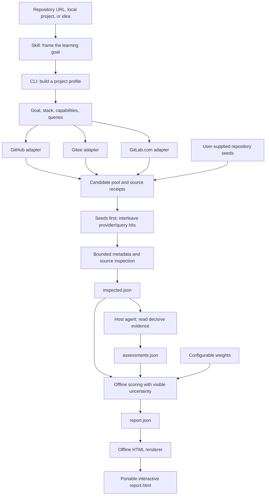

# How Repo Scout works

Repo Scout separates repeatable data work from judgment. The Skill guides a compatible AI host, the Python CLI collects and scores evidence, and a self-contained HTML file delivers the result. There is no application server or separate model service in the core workflow.

The first-use entry is a repository link followed by a natural-language goal. The host reads the Skill and relevant scenario guidance; the Repo Scout link is the workflow reference, while the rest of the request defines the discovery target. A host with repository browsing can use its own research tools without installation. The optional Python helper automates collection, scoring and HTML rendering.



## Responsibilities

| Layer | Owns | Does not establish |
|---|---|---|
| Skill | Framing the task, choosing appropriate evidence, routing the host's work, delivering a useful shortlist | Permission to execute candidate code or publish private project information |
| Local profile | Bounded known manifests, technology names, relative evidence filenames, abstract search terms, explicit constraints | A complete business specification or runtime behavior |
| Provider adapters | Public repository identity, search results, metadata, timestamps, bounded README/manifests/tree evidence | Exhaustive search coverage or equal availability across hosts |
| Host review | Contextual relevance, actual stack, task-specific completeness, audience fit, useful reuse/study paths | Successful execution unless it was separately performed and reported |
| Scoring | Deterministic weighted judgments, score bounds, coverage, reproducible ordering | A universal quality leaderboard or enterprise certification |
| HTML report | Local filtering, comparison, scoring-priority changes, evidence links, accessible presentation | Background data refresh or hidden network requests |

## Selection is different from ranking

Discovery queries return a pool of candidates. Their provider ordering is an input to triage, not a quality assessment. The `run --limit` option is a total inspection budget of 1–30 projects; it does not truncate the saved search pool to that number.

1. Successfully resolved, distinct `--repo-seed` candidates reserve the first inspection slots.
2. The remaining query/provider buckets are interleaved, allowing each combination to contribute before taking deeper results from the first one.
3. Repository identities are deduplicated. A supplied repository that also appears in search keeps both provenance entries.
4. If distinct resolved seeds exceed the budget, the command reports an error rather than dropping requested candidates.
5. `search.json` retains collected candidates; `inspected.json` records inspected and unreviewed counts.

Interleaving reduces first-source bias; it does not promise that every source or query is represented when the budget is small. A failed provider remains a failed receipt, not an empty successful result. A successful empty search describes that query and API response, not the provider's entire catalog.

The separate `search --limit` option controls hits per provider/query. `inspect --limit` applies a total inspection budget to its input envelope.

## Evidence and scoring

The seven default dimensions are relevance, stack fit, completeness, maintenance, learning fit, reuse, and popularity. See [the scoring reference](../skills/repo-scout/references/scoring.md) for the weights and formula.

The CLI can produce a transparent heuristic first pass. A host review improves that pass by reading implementation paths and assigning explained, source-linked judgments. Structural evidence such as `tests/`, a CI file, or a Dockerfile must remain distinct from passing tests or a working deployment.

The same workflow supports business and graduation projects, AI images, video, audio and writing tools. `profile.constraints` records the user's operating limits without automatically adding them to public queries or certifying compatibility. Source-reviewed assessments can add `usage_requirements` with `usage_evidence` links for hardware, APIs, model or asset terms, costs and input/output requirements. The report displays these findings in project details and comparison; Repo Scout itself does not execute the creative tools.

Unknown values widen the score interval. A source-reviewed zero has evidence and is different from an unknown. Reports expose known-evidence coverage and source-review coverage separately. Audience labels describe individual/team/enterprise-oriented scope without treating size as an inherent advantage.

## Snapshot dates

| Date | Meaning |
|---|---|
| Repository `created_at` | When the hosting platform created the repository |
| `last_commit_at` | Collected default-branch commit timestamp, when available |
| `latest_release_at` | Latest collected release timestamp, when available |
| `pushed_at` | Provider push metadata; a fallback signal rather than proof of human maintenance |
| Report `retrieved_at` | Discovery collection time |
| Report `inspected_at` | Inspection completion time |
| Report `generated_at` | Scoring/report generation time |
| Candidate `retrieved_at` | Its own metadata retrieval time |

Offline rescoring changes report generation time while preserving collection and inspection dates. A report re-render is not a data refresh. Missing timestamps stay unknown.

## Files and boundaries

```text
skills/repo-scout/
├── SKILL.md                 Agent-facing workflow
├── agents/openai.yaml       Discovery metadata
├── references/              Assessment, scoring, source, workflow guidance
├── scripts/repo_scout.py    CLI entrypoint
├── scripts/scout/           Profiles, providers, scoring, rendering
└── assets/                  Embedded report styles and interactions
```

The whole folder is portable as a Skill. The CLI uses Python's standard library. `score` and `render` work without network access; readers need only the generated HTML. The report embeds its content and has no CDN, external font, analytics, or background API dependency.

Provider credentials are optional environment variables and stay out of saved reports. Local profiles use bounded known manifests and relative filenames; public queries should use abstract capabilities rather than proprietary identifiers. Candidate repositories are not cloned, installed, or executed by the collection workflow. See [provider details](../skills/repo-scout/references/providers.md) and the [data contract](data-contract.md).
